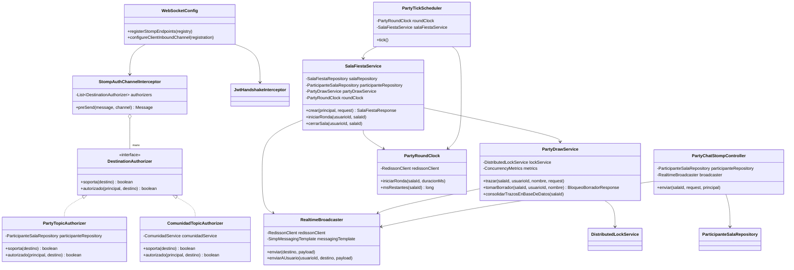
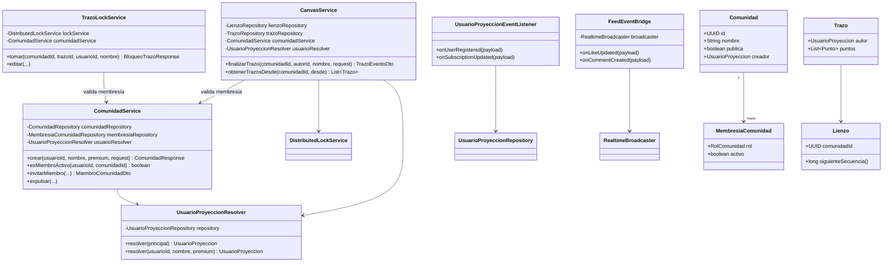

# artagram-canvas

Microservicio responsable del **lienzo**: canvas comunitario, banners, modo
fiesta, y la infraestructura de tiempo real (WebSocket/STOMP) que todos esos
módulos comparten. Es el destino final de lo que hoy vive en
`ARTAGRAM-backv1/src/main/java/com/artagram/platform/{canvas,party,realtime}`
(ver `artagram-infra/docs/PLAN_MIGRACION_ARTAGRAM.md`, Fase 7).

## Puerto y base de datos

- Puerto local: `8088` **temporal**. El puerto "definitivo" de la arquitectura
  es `8084` (el que hoy ocupa `artagram-lienzo`), pero como el monolito sigue
  vivo y usándolo, `artagram-canvas` corre aparte en `8088` sin que el gateway
  lo sepa, hasta que se decida el corte de tráfico (ver más abajo).
- Base de datos propia: `db_lienzo` (Postgres), ya creada por
  `artagram-infra/postgres/init-multiple-dbs.sql`.
- Redis: locks distribuidos (trazos, herramientas de fiesta) y relay Pub/Sub
  de `RealtimeBroadcaster` entre instancias.
- RabbitMQ: consume eventos de usuario (`user.registered`,
  `subscription.updated`) para la proyección local.
- `community` (comunidades/membresías) ya vive en este mismo servicio — ya
  no se consulta a `ARTAGRAM-backv1` para membresía. `LIENZO_INTERNAL_URL`
  queda solo para que otros servicios (`artagram-chat`) migren su cliente
  cuando corresponda.

## Qué ya está armado

- `pom.xml`, `Dockerfile`, `application.yml` — alineados con las convenciones
  (y los bugs ya corregidos) del resto de microservicios: variables de entorno
  `DB_HOST/PORT/NAME`, `REDIS_HOST/PORT`, `RABBITMQ_HOST/PORT/USER/PASSWORD`,
  `JWT_PUBLIC_KEY_PATH` apuntando a un archivo montado (no a una llave
  generada en memoria).
- `com.artagram.canvas.common.*` — trazabilidad (`X-Trace-Id` + MDC),
  `ApiException`/`ErrorResponse`/`GlobalExceptionHandler` con el mismo formato
  que usan `auth`/`users`/`feed`/`chat`, y CORS.
- `com.artagram.canvas.auth.JwtService`/`JwtUserResolver` — valida JWT RS256
  contra la llave pública de `artagram-auth` (archivo montado via
  `JWT_PUBLIC_KEY_PATH`, sin fallback HMAC: este servicio es nuevo, solo
  recibe tokens RS256).
- `com.artagram.canvas.realtime.*` — el endpoint STOMP único (`/ws`),
  autenticado con el mismo JWT que REST, con relay multi-instancia por Redis
  (`RealtimeBroadcaster`) y el mecanismo de autorización por destino
  (`DestinationAuthorizer`) que cada módulo (canvas, banner, fiesta) implementa
  para su propio patrón de topic.
- `com.artagram.canvas.usuario.*` — proyección local de usuario
  (`usuarios_proyeccion`), sincronizada por eventos de RabbitMQ
  (`user.registered`, `subscription.updated`) con fallback defensivo: si un
  usuario actúa antes de que su evento llegue, se crea al vuelo con los
  claims del propio JWT.
- **`com.artagram.canvas.party`** — modo fiesta completo, migrado desde
  `ARTAGRAM-backv1` y **probado end-to-end** contra la infra real: login →
  crear sala → unirse → chat de sala por WebSocket (incluyendo el rechazo de
  un usuario no participante). Ver la decisión de arquitectura del chat de
  fiesta más abajo.
- **`com.artagram.canvas.canvas`** — lienzo colaborativo (núcleo: dibujo en
  tiempo real, snapshot REST, bloqueo/edición exclusiva de trazo), migrado
  desde `ARTAGRAM-backv1` y **probado end-to-end**: crear comunidad →
  verificar membresía → dibujar por WebSocket → persistir →
  tomar/editar/liberar bloqueo de trazo → usuario no-miembro rechazado.
- **`com.artagram.canvas.community`** — comunidades, membresías y roles,
  migrado desde `ARTAGRAM-backv1` y **probado end-to-end**: crear comunidad →
  unirse → listar miembros → cambiar rol → expulsar → `misComunidades`. La
  membresía ya se valida 100% local (sin HTTP a backv1) desde
  `ComunidadTopicAuthorizer`, `CanvasService`, `TrazoLockService` y
  `CanvasController`. También expone `InternalCommunityController`
  (`GET /internal/communities/{id}/members/{usuarioId}`), mismo contrato que
  backv1, para cuando otros servicios (`artagram-chat`) quieran apuntar aquí.
  La cuota de "comunidades gratis" (3 por defecto) se calcula contando
  comunidades propias localmente — no toca la tabla `uso_cuenta` de
  `artagram-users`, que tiene un propósito distinto (almacenamiento). Ver
  `ComunidadService`/`ComunidadProperties`.
- **`com.artagram.canvas.feed.FeedEventBridge`** — retransmite por STOMP los
  eventos `like.updated`/`comment.created`/`comment.deleted` de
  `artagram-feed` hacia `/topic/publicaciones/{id}/likes` y `/comentarios`
  (lo que escucha `PostCard.tsx`), con colas propias (`canvas.*`) que no
  compiten con las `lienzo.*` de backv1 — ambos coexisten recibiendo copias
  independientes del mismo evento mientras dure la transición. **Probado
  end-to-end**: like real → mensaje STOMP recibido con el contador correcto.
  De paso se corrigió el mismo bug en `ARTAGRAM-backv1/LienzoEventBridge`
  (confirmado en vivo con un WARN real en sus logs): leía `postId`/
  `totalLikes`/`totalComentarios` del payload, pero `FeedEventPublisher`
  publica `publicacionId`/`contadorLikes`/`contadorComentarios` — el
  `UUID.fromString` reventaba, la excepción se tragaba, y el evento nunca
  llegaba a STOMP. Era un bug real y ya activo, no introducido por esta
  migración.
- **`com.artagram.canvas.chat`** — chat de comunidad y chat personal **en
  vivo** por STOMP, migrado desde `ARTAGRAM-backv1`. Sin persistencia local:
  `artagram-chat` sigue siendo el único dueño de la persistencia (su propio
  Mongo); este paquete solo transmite en vivo y publica un evento para que
  `artagram-chat` guarde — `room.message` para comunidad (contrato que ya
  existía, `artagram-chat` ya lo consumía desde antes, cero cambios ahí) y
  el nuevo `personal.message.sent` para chat personal (requirió un listener
  + método nuevo en `artagram-chat`, ver `ChatPersonalService.guardarDesdeStomp`
  y `ChatEventListener.onPersonalMessage`). `ComunidadTopicAuthorizer` se
  extendió para proteger también `/topic/comunidad/{id}/chat` (antes solo
  cubría `lienzo/{id}`).
- **`com.artagram.canvas.banner`** — banner comunitario (HU-16: mural
  1000×1000 particionado en regiones, pintado por REST o STOMP, consolidado
  a snapshots PNG por `BannerSnapshotJob`), migrado desde `ARTAGRAM-backv1`,
  como paquete propio (no dentro de `canvas/`: rate limiter, raster y
  snapshot job son responsabilidades propias del banner, no del lienzo).
  Sigue la misma convención de autorización que el resto
  (`BannerTopicAuthorizer`, cero cambios en `StompAuthChannelInterceptor`
  para agregarlo). El chequeo de admin-global ya no consulta un
  `UsuarioRepository`: llega como el claim `rolGlobal` del JWT (ver el
  javadoc de `BannerService.pintar`). **Falta probarlo end-to-end** contra
  la infra real (Docker estaba caído durante este port) — a diferencia de
  `party`/`canvas`/`community`, que sí lo están.

## Qué falta migrar (fuera de este scaffold, en PRs siguientes)

- **`observability`** (`eventos_negocio`/KPIs, `/api/admin/**`) — solo en
  backv1; requiere decidir una estrategia de agregación propia antes de
  portar (no es un copy-paste: el `KpiService` del monolito agrega sobre
  datos que hoy viven repartidos en varios servicios).
- Un endpoint interno en `artagram-users` si se decide medir cupo de "salas
  de fiesta activas" (hoy no existe — ver `SalaFiestaService` para el porqué
  no bloquea el port de `party`).
- Invitar por nombre de artista (`invitarMiembro`) solo encuentra usuarios ya
  conocidos localmente (sincronizados por evento o creados al vuelo) — no
  busca contra `artagram-users`. Ver `UsuarioProyeccionRepository`.

## Decisión de arquitectura: chat de fiesta vs. chat normal

(Ver también `com.artagram.canvas.party` — `package-info.java`.)

- **Chat personal y de comunidad**: la persistencia y el REST/SSE siguen en
  `artagram-chat` — sigue siendo la fuente de verdad. Lo que SÍ vive aquí
  ahora (migrado desde backv1) es la entrega en vivo por STOMP
  (`com.artagram.canvas.chat`), porque `/ws` ya es de este servicio; canvas
  no persiste nada, solo transmite y publica el evento que `artagram-chat`
  consume para guardar. Ver `com.artagram.canvas.chat` más arriba.
- **Chat dentro de una sala de fiesta**: SÍ es síncrono (va por el mismo canal
  STOMP que el dibujo colaborativo), porque la sala ya es una sesión en vivo
  con rondas cronometradas. Vive en este microservicio, no en `artagram-chat`.
- `PartyTopicAuthorizer` ya autoriza genéricamente cualquier destino bajo
  `/app|/topic/fiesta/{salaId}/...` verificando participación activa en la
  sala — agregar `/app/fiesta/{salaId}/chat/enviar` y
  `/topic/fiesta/{salaId}/chat` no requiere tocar autorización.
- Por defecto el chat de fiesta **no se persiste** (sala efímera). Si se
  decide guardar historial, se reutiliza el mismo patrón que ya usa el chat
  de comunidad: publicar un evento a RabbitMQ para que `artagram-chat` lo
  guarde en Mongo.

## Cómo correrlo en local

Ya está agregado a `artagram-infra/compose.services.yml` (puerto `8084`,
mismo slot que `artagram-lienzo`). Para levantarlo junto al resto de la pila:

```bash
cd artagram-infra
docker compose -f compose.yml -f compose.services.yml up -d --build artagram-canvas
```

Para correrlo suelto contra la infra ya levantada, sin Docker:

```bash
cp .env.example .env   # ajustar si los puertos/credenciales no son los default
mvn spring-boot:run
```

## Diseño y Arquitectura

Este es el servicio con más superficie de todo el workspace (4 dominios:
`party`, `canvas`, `community`, `usuario`), así que el diagrama se separa en
dos vistas para que queden legibles.

### Diagrama de clases — tiempo real + modo fiesta



### Diagrama de clases — lienzo + comunidad + proyección de usuario



### Análisis SOLID

- **SRP (parcialmente cumplido).** `UsuarioProyeccionResolver`, `PartyRoundClock`,
  `RealtimeBroadcaster` y `DistributedLockService` tienen una responsabilidad
  bien acotada cada uno. Pero `SalaFiestaService` mezcla tres cosas (ciclo de
  vida de la sala, orquestación de rondas, y notificación por broadcast) y
  `PartyDrawService` mezcla dibujo con locks de herramientas/borrador — están
  así porque así estaba en el monolito migrado, no es una decisión nueva, pero
  si el servicio sigue creciendo (banner) conviene partir `SalaFiestaService`
  en creación/membresía de sala vs. orquestación de rondas.
- **OCP (el punto más fuerte del servicio).** `DestinationAuthorizer` es
  Strategy real: `StompAuthChannelInterceptor` itera `List<DestinationAuthorizer>`
  inyectada por Spring sin conocer `PartyTopicAuthorizer` ni
  `ComunidadTopicAuthorizer` — agregar un autorizador nuevo (p. ej. para
  banner) es añadir una clase `@Component`, cero cambios en el interceptor.
- **LSP.** Sin jerarquías de herencia de negocio (solo `BaseEntity` como
  `@MappedSuperclass` técnico) — no hay superficie para violarlo.
- **ISP.** `DestinationAuthorizer` tiene 2 métodos, acotada. Los repositorios
  Spring Data son finos por construcción. Sin interfaces infladas.
- **DIP (cumplido a nivel de framework, no de abstracciones propias).** Todo
  se inyecta por constructor (ningún `new ServicioX()` disperso), pero
  `CanvasService`/`TrazoLockService` dependen de la clase concreta
  `ComunidadService`, no de una interfaz — swap de implementación exigiría
  tocar la clase, no solo registrar otro bean. Dado que `community` vive en
  este mismo proceso y no hay un segundo proveedor previsible, es un gap
  menor y consciente, no un descuido.

### Extensibilidad

- **Nuevo canal en tiempo real** → implementar `DestinationAuthorizer` +
  `@MessageMapping`, reusando `RealtimeBroadcaster`/`WebSocketConfig` tal cual.
- **Historial de chat de fiesta** → `PartyChatStompController` ya está aislado
  de persistencia; agregar un publish a RabbitMQ ahí no toca el resto de `party`.
- **Banner comunitario** → ya migrado (`com.artagram.canvas.banner`), como
  paquete propio en vez de dentro de `canvas/` (más cohesión: rate limiter,
  raster y snapshot job son responsabilidades propias del banner, no del
  lienzo) reusando `ComunidadService` para membresía y `RealtimeBroadcaster`
  para el canal — mismo patrón que `Lienzo`.

### Preparación para AWS

| Pieza local | Equivalente AWS | Nota |
|---|---|---|
| Postgres (`db_lienzo`) | **RDS PostgreSQL** (Multi-AZ) | Un solo esquema compartido por `canvas`+`community`+`party` — mantiene el diseño de "un servicio, una base". |
| Redis (locks + `RealtimeBroadcaster`) | **ElastiCache for Redis** | Crítico: si se pierde, el relay multi-instancia deja de funcionar (cada instancia del servicio quedaría aislada). Usar modo cluster-disabled con réplica es suficiente al tamaño actual. |
| RabbitMQ | **Amazon MQ (RabbitMQ)** | Las colas `canvas.*` se declaran por código (`QueueBuilder`), no por `definitions.json` — no hay que migrar definiciones manualmente. |
| WebSocket (`/ws`) | **ALB** con *sticky sessions* (o **NLB** si se prefiere) | El `SimpleBroker` es en memoria por instancia; sin sticky sessions una reconexión podría caer en otra instancia y perder las suscripciones hasta que el cliente vuelva a suscribirse (no pierde mensajes ya enviados, pero sí la sesión STOMP). |
| `JWT_PUBLIC_KEY_PATH` (archivo montado) | **Secrets Manager** o **Parameter Store** (SecureString) | Cambiar `JwtService` para leer de variable de entorno con el PEM inline (`JWT_PUBLIC_KEY_PEM`, ya soportado) en vez de archivo montado — evita volúmenes/secrets como archivos en ECS/Fargate. |
| Escalado | Horizontal, sin estado de sesión en JVM | Los únicos estados "pegajosos" son: conexión WS (resuelto con sticky sessions) y locks en Redis (ya centralizados) — el servicio en sí es stateless y escala sin fricción. |
